<div align="center">


# bunk

bunk is a terminal for coding agents. In bunk-gui, its GTK 4 app, you run Claude Code, Codex, Copilot CLI and other agents in tabs and splits. Each tab shows whether its agent is working, waits for you, has finished or has failed, and <kbd>Alt</kbd>+<kbd>A</kbd> takes you to the agent that needs you. When an agent writes a plan or a report for you, it opens in a panel beside the agent.

[](https://github.com/jsnjack/bunk/releases)
[](LICENSE)
[](#install)
[](#bunk-in-any-terminal)

[Features](#features) · [Documents](#documents-beside-the-agent) · [Agent hooks](#agent-hooks) · [Performance](#performance) · [Terminal protocols](#terminal-protocols) · [Install](#install) · [Documentation](#documentation)

<br>

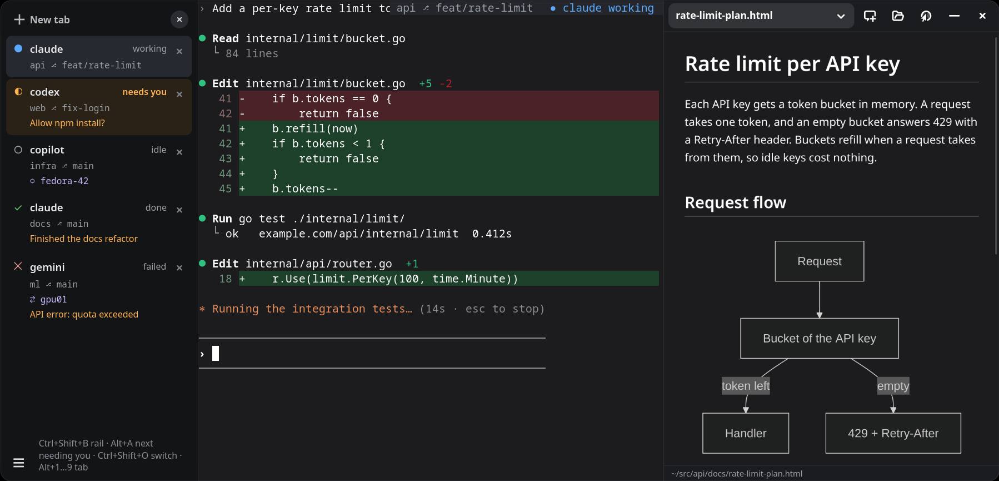

<sub>Recognises Claude Code, Codex, Copilot CLI, Gemini CLI, opencode, Aider, Cursor, Amp, Goose, Qwen Code, Crush, Droid, Auggie, Cline and Kimi, and any CLI you add.</sub>

</div>

<br>

<table>
<tr>
<td width="25%" valign="top">

### ● Agent status

Every tab shows its agent, repo ⎇ branch, SSH host or container and the agent's last notice, in the colour of its state.

</td>
<td width="25%" valign="top">

### ▤ Documents

Agents show you plans, reports and diagrams in a panel beside their pane. Select a passage to ask the agent about it.

</td>
<td width="25%" valign="top">

### ◐ Alt+A

A desktop notification tells you when an agent you are not watching needs you, and <kbd>Alt</kbd>+<kbd>A</kbd> takes you there.

</td>
<td width="25%" valign="top">

### ↻ Session restore

The next start brings your windows back, with their splits, folders and scrollback, and each agent resumes its conversation.

</td>
</tr>
</table>

## Features

### States in the rail

The collapsed rail draws each tab as a ring. A tab with split panes gets one arc per pane, and each arc faces its pane, so a tab running three agents shows which of them waits for you. A plain shell's arc is dimmed, so the agents stand out.

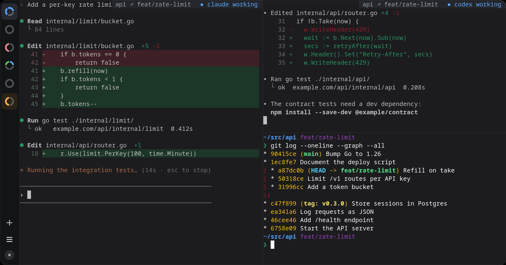

<table>
<tr>
<td width="18%" align="center" valign="top">


<sub>ring</sub>

</td>
<td width="18%" align="center" valign="top">

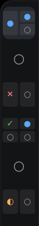

<sub>map</sub>

</td>
<td valign="top">

The states have the same glyph and colour everywhere: in the rail, the tab bar, the switcher and the pane badges.

| | State | Meaning |
| :- | :- | :- |
| ● | Working | The agent is busy, or a long command runs |
| ◐ | Needs you | The agent asks a question or a permission |
| ✓ | Done | The agent's turn ended, and you have not looked yet |
| ✕ | Failed | The agent failed, or a command exited non-zero |
| ○ | Idle | The agent waits at its prompt, or the pane is a shell |

With `rail_style = "map"`, the rail draws a tab of two to four panes as a small map of them instead, each cell with its pane's glyph.

</td>
</tr>
</table>

Hold <kbd>Alt</kbd> on its own for a moment and each ring gets a label with its tab's key, agent, repo ⎇ branch and the host or container it runs in. The panes dim while the labels show, and <kbd>Alt</kbd>+<kbd>1</kbd>…<kbd>9</kbd> switches tabs before you let go.

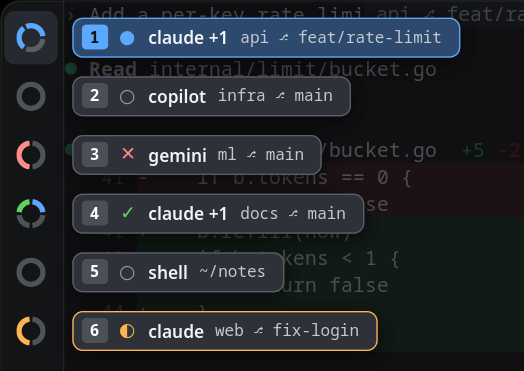

### Documents beside the agent

An agent can show you what it wrote for you to read in a panel beside its pane: a plan before it starts, a report when it is done, or an explanation with a diagram. It runs `bunk-gui present docs/plan.html`, as claude did in the picture at the top. Agents prefer HTML pages, which can be interactive, and bunk gives them the parts, so they write the content rather than the widgets: interactive charts with Apache ECharts, Graphviz and Mermaid diagrams, KaTeX math, D3, highlighted code, sortable and filterable tables, tabs, step-throughs, callouts and badges. Pages run without network access, in your theme's colours.

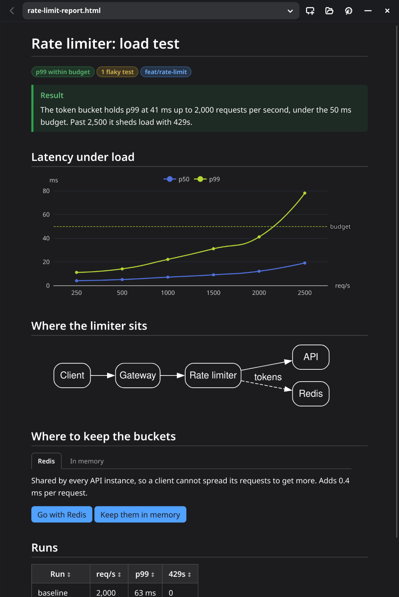

The page reloads as the agent edits the file. It keeps your place, the tabs you chose and what you typed, and marks the sections that changed. `bunk-gui present` waits for the page to draw and tells the agent what is wrong with it, such as a diagram that does not parse, a script error or a missing image, so the agent fixes its own page; `bunk-gui present plan.html#rollout` opens it at the section the agent wants you to read.

Select a passage and choose "Ask the agent": your question is pasted into the agent's input with the file, the section and the quote, and waits there for you to send it. To review a plan, add comments instead: their passages stay highlighted, and the Review button pastes them all as one message. A page can also offer buttons that answer the agent, such as "Go with Redis" above. When Claude Code or Copilot CLI asks you to approve a plan, the plan opens in the panel too.

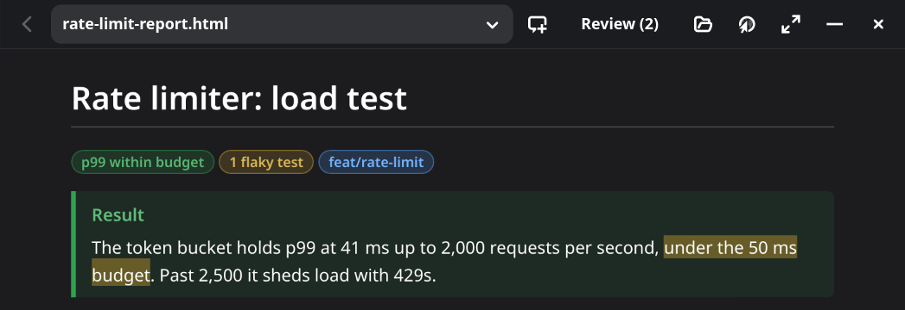

While the panel has the keyboard, <kbd>Ctrl</kbd>+<kbd>F</kbd> finds in the document and the text size keys zoom it. A link to another document beside it opens that document, and Back returns. Markdown renders with tables that sort, highlighted code, diagrams, charts, math and GitHub's `> [!NOTE]` callouts. "Open in the browser" shows the page in your browser, light or dark as your system is set.

The panel previews other files as well, from "Open in panel…" or a drop: images, PDFs, video, audio, and code highlighted by its file name. The agent hooks tell each agent about the panel when a session starts, and `bunk-gui present install claude` (or `codex`, `copilot`) adds a skill that says when and how to present. [docs/present.md](docs/present.md) covers the formats, the sandbox and the skill.

### Badges on every pane

Each pane carries badges for its agent's state and notice, its SSH host or container, a zoomed view, keyboard passthrough and how far it is scrolled back. A command that runs longer than 10 s gets a badge too, and keeps "done" or "failed" until you look at it. bunk's terminal UI draws the same badges from the same code.


### Notifications and Alt+A

When an agent in a pane you are not watching needs you, finishes or fails, bunk-gui posts a desktop notification such as "claude on gpu01 needs you" with the agent's question and its repo ⎇ branch. Clicking it raises the window and focuses that pane, and looking at the pane withdraws it. A command that ran for 10 s or longer notifies when it ends, such as "tar finished after 2m 14s".

<kbd>Alt</kbd>+<kbd>A</kbd> visits the tabs and panes that need you, then the ones that are done. A question an agent asks through its hooks stays marked until you answer it, so a glance at the pane does not lose it.

### Switcher

<kbd>Ctrl</kbd>+<kbd>Shift</kbd>+<kbd>O</kbd> lists every tab with its repo, branch, agent and folder, in tab order. Type to filter by any of them, and Enter opens the tab. A row's × closes its tab, and the switcher stays open, so you can clear out finished tabs in one place.

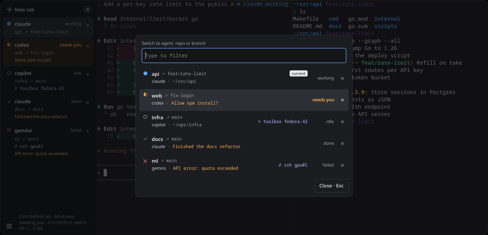

### Session restore

bunk-gui saves each window as it changes, so a crash or a logout loses at most a few seconds. The next start offers the windows back in a banner. Restore brings back the tabs, splits, folders and scrollback, and each agent pane runs the agent's resume command, such as `claude --resume` with the session ID its hooks reported. A pane that ran `ssh` gets the command typed at the prompt, ready to run.

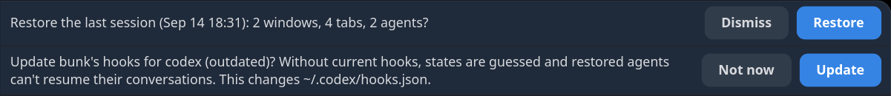

### Works like your terminal

bunk-gui's default keys are those of Ptyxis, GNOME's terminal, plus bunk's own: <kbd>F2</kbd> opens a tab, <kbd>Ctrl</kbd>+<kbd>←</kbd> and <kbd>Ctrl</kbd>+<kbd>→</kbd> switch tabs, <kbd>F1</kbd> splits and <kbd>F12</kbd> zooms a pane.

- <kbd>Ctrl</kbd>+<kbd>C</kbd> copies while text is selected and ends the selection. With nothing selected it reaches the program, so it still stops what runs.
- <kbd>Ctrl</kbd>+<kbd>V</kbd> pastes text. An image on the clipboard pastes as the path of a PNG file, which agents attach.
- The shortcuts window (<kbd>Ctrl</kbd>+<kbd>Shift</kbd>+<kbd>?</kbd>) rebinds any action and marks keys that terminal programs use. <kbd>Ctrl</kbd>+<kbd>F12</kbd> sends every key to the program in one pane.
- Every pane is a real PTY, so agents, vim, btop and shells behave as they do in any terminal.

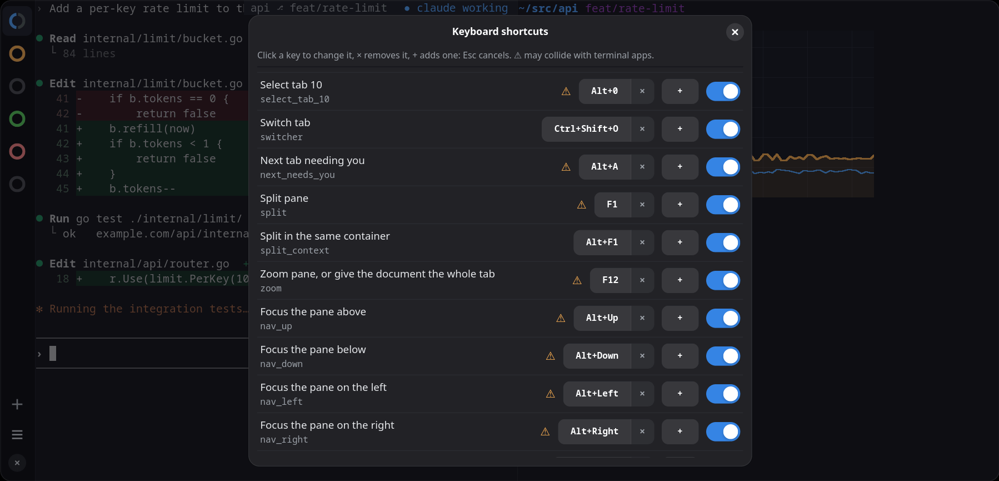

### Images, links and drawing

Programs see real cell pixels, and bunk-gui draws their SIXEL, Kitty and iTerm2 images 1:1 in device pixels. It draws box drawing, block, braille and powerline characters itself, so lines join across cells without seams. Colour emoji keep their colours. <kbd>Ctrl</kbd>+click opens OSC 8 links and plain URLs.

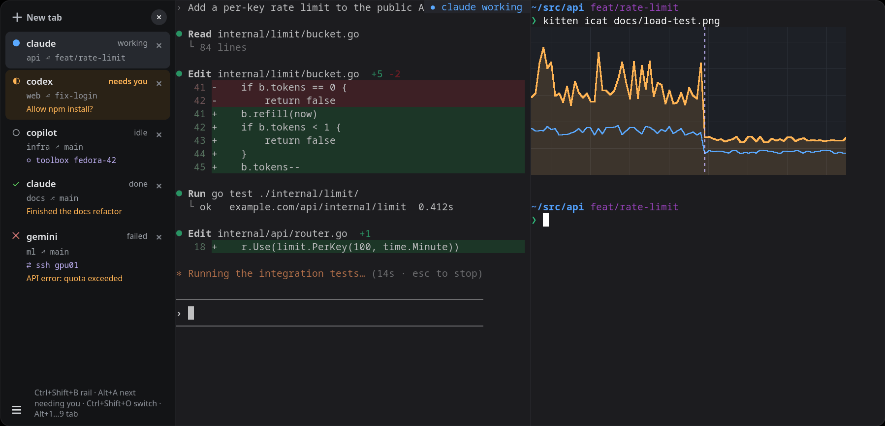

<table>
<tr>
<td width="50%">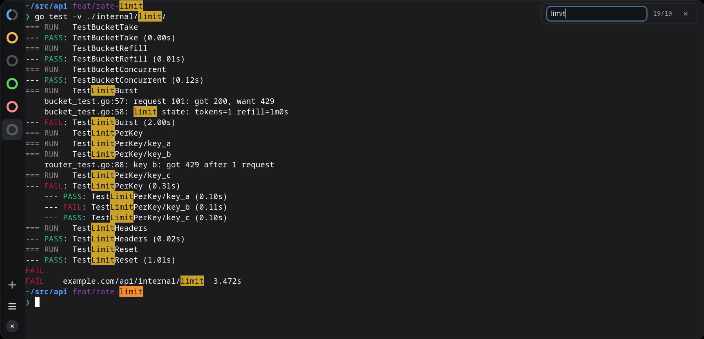</td>
<td width="50%">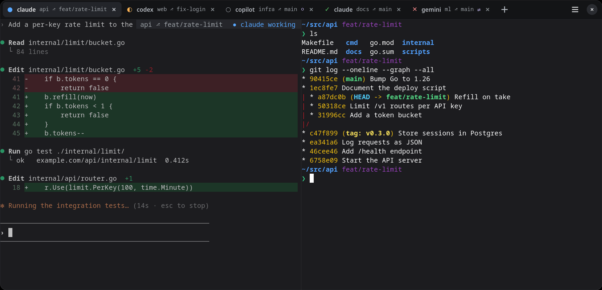</td>
</tr>
<tr>
<td>Find (<kbd>Ctrl</kbd>+<kbd>F</kbd>) searches the scrollback and the screen, with the rail collapsed.</td>
<td>With <code>tabs = "bar"</code>, the tabs sit in a bar on top.</td>
</tr>
</table>

## Agent hooks

Without hooks, bunk infers an agent's state from its output, bells and OSC notifications. With hooks, Claude Code, Codex, Copilot CLI and Gemini CLI report their own state, the question they ask and the session ID that restore resumes. One command sets them up, and bunk-gui offers the same in a banner and in Preferences.

```bash
# Each agent's hooks: installed, outdated or missing
bunk-gui notify hooks
# Merge bunk's hooks into ~/.claude/settings.json, keeping a backup
bunk-gui notify hooks install claude
```

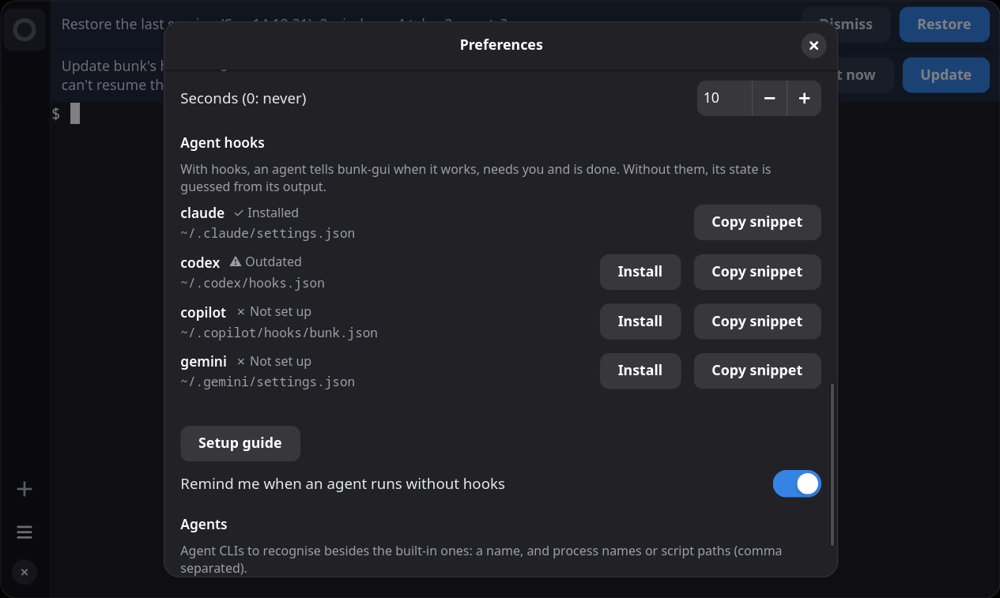

Agents on hosts you reach over ssh report to the tab that runs ssh. Install bunk on the server and the same hooks there; plain `ssh` works, and the tab shows the remote agent's name, repo and branch.

[docs/agent-hooks.md](docs/agent-hooks.md) has the snippets for each agent, the wire format and the setup steps. [docs/agent-status.md](docs/agent-status.md) explains how states are inferred and when they notify.

## Performance

<table>
<tr>
<td width="25%" align="center">

### 445 MB/s

plain text parsed by one core

</td>
<td width="25%" align="center">

### 200 MB/s

agent transcripts parsed by one core

</td>
<td width="25%" align="center">

### 0.1 ms

of CPU time to build a full 240×70 frame

</td>
<td width="25%" align="center">

### 0 frames

drawn by an idle window

</td>
</tr>
</table>

Each pane draws into a texture at its device-pixel size, so text stays on the pixel grid at 133% and other fractional scales. A program that floods its pane with output, or stops reading its input, slows only that pane: writes to a pane never block the window. The figures come from `make bench-check`, pinned to one core of a Ryzen AI 9 HX PRO 370, and [testdata/bench-baseline.txt](testdata/bench-baseline.txt) records the runs. Every test run also checks that sessions, panes and tabs give back their file descriptors, goroutines, child processes and memory.

## Terminal protocols

Both front ends share one emulator, so they support the same sequences. Each pane answers queries itself, also over SSH.

| Input | Text and graphics | Shell and desktop |
| :- | :- | :- |
| Kitty keyboard protocol | Truecolour, underline styles and colours, overline | OSC 7 working directory |
| SGR mouse reports | Kitty graphics | OSC 8 hyperlinks |
| Bracketed paste | SIXEL | OSC 52 clipboard |
| Focus reports | iTerm2 inline images | OSC 133 shell integration |
| Application cursor and keypad modes | Grapheme clusters (mode 2027) | OSC 9;4 progress |
| DECSCUSR cursor shapes and blink | Synchronized updates (mode 2026) | OSC 9, 99 and 777 notifications |
| | Reflow on every resize | DA, DECRQM, DECRQSS, XTVERSION and XTGETTCAP replies |

[TERMINAL_AUDIT.md](TERMINAL_AUDIT.md) lists every sequence with its status and limits.

## bunk in any terminal

bunk is the same core as a terminal UI. It adds split panes, badges, agent status and notifications to any terminal emulator, so it works over SSH, on servers and on macOS. <kbd>Alt</kbd>+<kbd>F1</kbd> opens a shell in the same container, SSH host or sudo session, and the split follows the pane's shape in pixels.

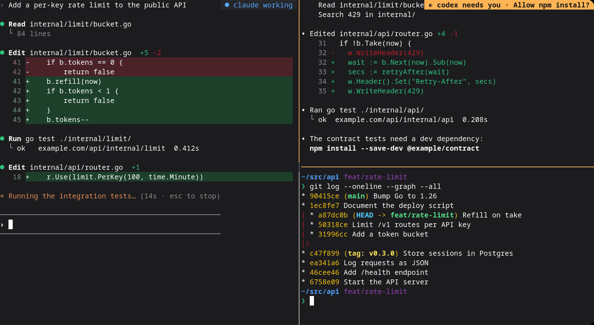

## Install

### bunk-gui

On Fedora x86_64, download `bunk-gui-<version>-1.*.x86_64.rpm` from [Releases](https://github.com/jsnjack/bunk/releases) and install it; dnf pulls in GTK 4 and libadwaita:

```bash
sudo dnf install ./bunk-gui-*.x86_64.rpm
```

[docs/development.md](docs/development.md#building) shows how to build it from source on other distributions.

### bunk

```bash
grm install jsnjack/bunk
```

You can also download a binary from [Releases](https://github.com/jsnjack/bunk/releases) for Linux and macOS, on amd64 and arm64. [docs/configuration.md](docs/configuration.md#starting-bunk-in-every-terminal) shows how to start bunk in every new terminal.

## Documentation

| Page | What it covers |
| :- | :- |
| [Features and keys](docs/features.md) | Every feature of bunk-gui and bunk with its default keys, and the badges |
| [Configuration](docs/configuration.md) | Both config files, themes, keys and command-line flags |
| [Agent status and notifications](docs/agent-status.md) | How states are inferred, the rail's rings and maps, notifications and command marks |
| [Agent hooks](docs/agent-hooks.md) | Hook setup and snippets for each agent, the notify CLI and the wire format |
| [Remote agent status](docs/remote-agent-status.md) | How agents on hosts reached over ssh report their state |
| [Documents](docs/present.md) | The document panel, `bunk present`, its formats and sandbox, hooks and the agent skill |
| [Development](docs/development.md) | Packages, building, tests and the README pictures |
| [Terminal audit](TERMINAL_AUDIT.md) | Every terminal sequence with its status |

## License

MIT, see [LICENSE](LICENSE).
