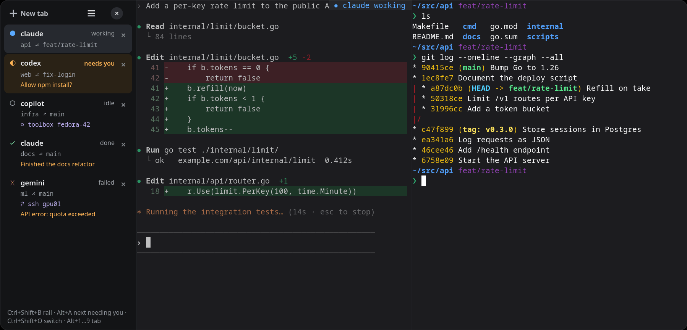
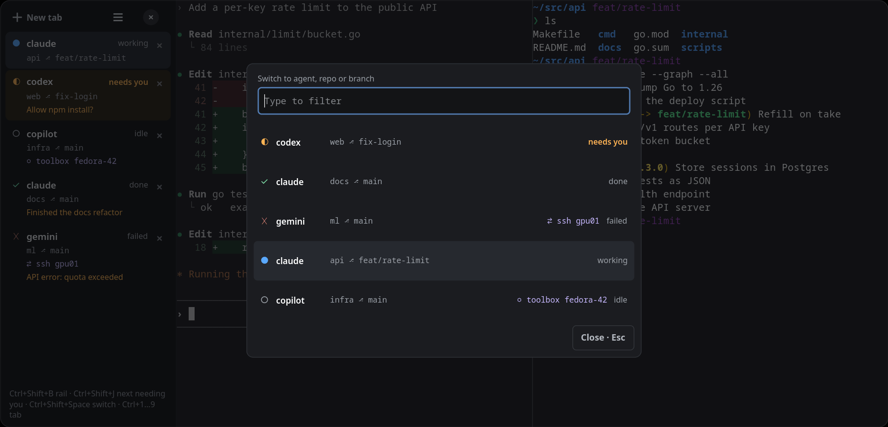
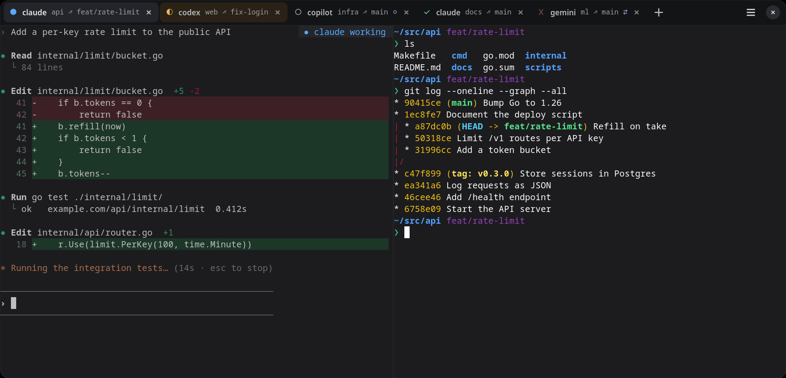
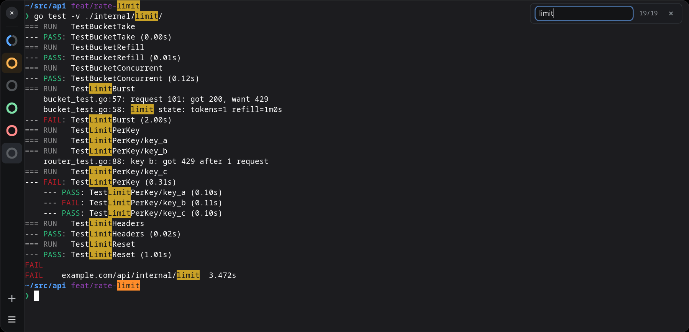
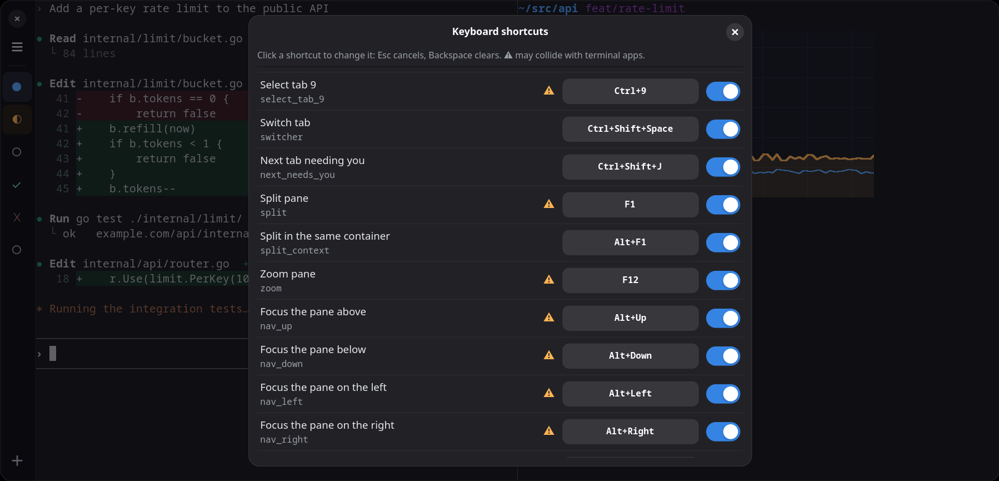
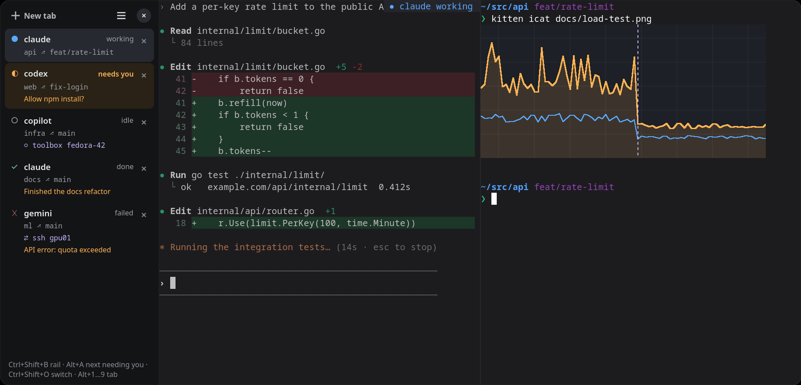
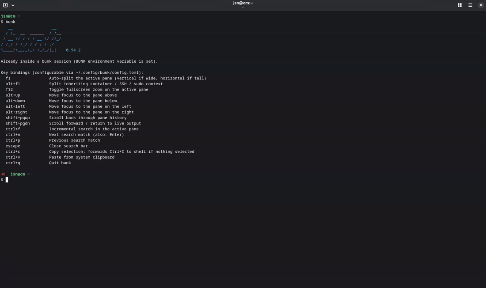

<div align="center">

# bunk

**bunk** adds split panes to any terminal. **bunk-gui** is a native GTK4 terminal for running coding agents side by side.



</div>

---

## Main idea

A coding agent spends minutes on a task, then waits for an answer. With several agents running, you lose time checking each terminal.

- **Agent workspaces.** bunk-gui gives each agent a tab with its repo, branch, container or SSH host, and state.
- **Five states.** Each tab shows working, idle, needs you, done or failed.
- **Status in the TUI too.** bunk shows the same states on a badge in each pane.
- **Next needing you.** One key jumps to the next agent that waits for you: Ctrl+Shift+J in bunk-gui, Alt+A in bunk.
- **Real PTYs.** Every pane is a real PTY. Agents, vim, btop and shells behave as in any terminal.

Both front ends run on one Go core. `internal/session` owns the PTY, the emulator, scrollback, reflow, search and agent status. Each front end adds input and drawing.

| | bunk | bunk-gui |
| :- | :- | :- |
| Runs in | Any terminal: local, SSH, containers | Its own window on Linux (GTK4, libadwaita) |
| Draws with | tcell, in the host terminal's cells | Its own OpenGL renderer, in device pixels |
| Organises work as | Split panes, with agent status per pane | Tabs of split panes, with agent status per tab |
| Use it for | Splits wherever a terminal runs | Several agents side by side on a desktop |

- **Why the TUI.** bunk runs inside any terminal emulator, so it works over SSH and on servers.
- **Why the GUI.** Only a native window gets real pixels, every key event and the GPU.
- **Pixel-exact text.** bunk-gui draws each pane into a texture at the widget's device-pixel size. Text stays on the pixel grid at 133% and other fractional scales.

## In progress

- **New window.** Deferred: Ctrl+Shift+N shows "not built yet".

## bunk-gui

<table>
<tr>
<td width="50%"></td>
<td width="50%"></td>
</tr>
<tr>
<td>Switcher (Ctrl+Shift+Space): needs-you first, filter by agent, repo or branch</td>
<td>Tabs on top: <code>tabs = "bar"</code></td>
</tr>
<tr>
<td></td>
<td></td>
</tr>
<tr>
<td>Find (Ctrl+Shift+F) with the rail collapsed</td>
<td>Shortcuts window (Ctrl+Shift+?): click a key to rebind it</td>
</tr>
</table>

| Feature | Default keys | Details |
| :- | :- | :- |
| New / close tab | Ctrl+Shift+T / Ctrl+Shift+W | A new tab starts in the current pane's directory |
| Switch tab | Ctrl+PgDn / Ctrl+PgUp, Ctrl+Tab / Ctrl+Shift+Tab, Ctrl+1…9 | |
| Rail | Ctrl+Shift+B | Expands or collapses the side rail; the menu or `tabs` switches to the bar |
| Agent status | | Dot, state, repo ⎇ branch, container or SSH host, and the agent's notice; see [Agent status and hooks](#agent-status-and-hooks) |
| Switcher | Ctrl+Shift+Space | Lists needs-you tabs first; type to filter |
| Next needing you | Ctrl+Shift+J | Visits needs-you tabs, then done tabs, and acknowledges each |
| Split | F1 / Alt+F1 | Side by side or stacked by pane shape; Alt+F1 opens a shell in the same container |
| Zoom pane | F12 | |
| Move between panes | Alt+arrows | |
| Find | Ctrl+Shift+F | Enter or Ctrl+Shift+G: next; Shift+Enter: previous; Esc keeps the scroll position |
| Scrollback | Shift+PgUp / Shift+PgDn | |
| Copy / paste | Ctrl+Shift+C / Ctrl+Shift+V | Selecting copies to the primary selection; middle click pastes it |
| Text size | Ctrl+= / Ctrl+- / Ctrl+0 | |
| Images | | SIXEL, Kitty and iTerm2 images drawn at full resolution, 1:1 in device pixels |
| Links | Ctrl+click | Opens OSC 8 links and plain http, https and file URLs; Ctrl+hover underlines them |
| Passthrough | Ctrl+F12 | Per pane: every other key goes to the program; a PASS badge shows it |
| Shortcuts window | Ctrl+Shift+? | Rebind or turn off any action; ⚠ marks keys terminal programs may use |
| Preferences | Ctrl+, | Layout, rail, font, text zoom and extra agent CLIs |
| Quit | Ctrl+Shift+Q | Asks first while a pane runs more than an idle shell |

Programs in a pane see real cell pixels through TIOCGWINSZ and CSI 14/16/18 t. bunk-gui draws their images 1:1:



- **Image memory.** Each pane keeps up to 64 MiB of bitmaps (`-image-bytes`). Images drawn least recently fall back to half-block cells.
- **A program that stops reading.** The window and other panes keep working. Its pane queues up to 16 MiB of input (`-input-bytes`); more is refused with a toast.
- **Links while a program reads the mouse.** Ctrl+Shift+click opens the link instead.

## bunk



| Feature | Default keys | Details |
| :- | :- | :- |
| Split | F1 | Direction from the pixel cell aspect ratio, not the column count |
| Split in the same context | Alt+F1 | New shell in the same container, SSH host or sudo |
| Zoom pane | F12 | Other panes stay open |
| Move between panes | Alt+arrows | |
| Scrollback | Shift+PgUp / Shift+PgDn | 10 000 lines per pane, kept through vim and other alt-screen programs |
| Search | Ctrl+F | Enter or Ctrl+N: next; Ctrl+P: previous; Esc: exit |
| Copy / paste | Ctrl+C / Ctrl+V | Ctrl+C reaches the program when nothing is selected |
| Passthrough | Ctrl+F12 | Per pane: every other key goes to the program |
| Agent status | | A badge per pane: working, idle, needs you (amber), done (green) or failed, with the agent's notice |
| Next needing you | Alt+A | Focuses the next pane whose agent needs you, else one that is done |
| Re-initialise host terminal | Alt+R | Recovers after binary output corrupts the host |
| Quit | Ctrl+Q | Ctrl+D or `exit` closes one pane |
| Mouse | | Click focuses, drag selects, double click selects a word; Shift overrides program mouse mode |
| Reflow | | Text rewraps at the new width on every split and resize |
| Themes | | `terminal` (host colours), `default`, `solarized-dark`, `dracula`, `nord` |

Alt+F1 supports Podman, Docker, LXD/LXC, Incus, Toolbox, Distrobox, SSH and sudo/su.

Badges in the top-right corner of each pane:

| Badge | Meaning |
| :- | :- |
| `◐ claude needs you · Allow npm install?` | The agent's state and notice; needs you and done fill the badge |
| `⬡ mycontainer` | Podman, Docker, LXD, LXC or Incus container |
| `▣ my-toolbox` | Toolbox or Distrobox container |
| `⇄ myserver.com` | SSH session |
| `sudo` / `su` | Elevated shell |
| `PASS` | Keyboard passthrough on; shown first when badges do not fit |
| `ZOOM` | Pane zoomed with F12 |
| `-42` | Scrolled back 42 lines |
| `COPIED` | Selection copied to the clipboard |

The separators around a pane that needs you or is done take the badge's colour.

## Terminal emulation

Both front ends share the emulator, so they support the same sequences.

- **Colour and text.** Truecolour, SGR underline styles and colours, overline, dim, strike-through.
- **Integration.** OSC 8 links, OSC 52 clipboard, OSC 133 command status, bracketed paste, focus reports.
- **Host passthrough.** bunk forwards OSC 7, OSC 8 links and OSC 133 to the host terminal.
- **Input.** Kitty keyboard protocol, application cursor and keypad modes, SGR mouse reports.
- **Unicode.** Wide characters, combining marks and emoji sequences stay together through copy, search and reflow.
- **Images.** SIXEL, Kitty and iTerm2 static images. bunk-gui draws them at full resolution; bunk draws half-block cells.
- **Queries.** Each pane answers DA, DECRQM, DECRQSS and XTGETTCAP itself, also over SSH.
- **Throughput.** A session parses agent transcripts at about 180 MB/s and plain text at 400 MB/s on one core.

[TERMINAL_AUDIT.md](TERMINAL_AUDIT.md) lists every feature with its status and limits.

## Install

### bunk

```bash
grm install jsnjack/bunk
```

Or download a binary from [Releases](https://github.com/jsnjack/bunk/releases) (Linux and macOS, amd64 and arm64).

To start bunk in every new terminal, add this to `~/.bashrc` or `~/.zshrc`:

```bash
if [[ -t 1 ]] && [[ -z "$BUNK" ]] && [[ -z "$SSH_TTY" ]] && command -v bunk &>/dev/null; then
    exec bunk
fi
```

bunk sets `BUNK=1` in every pane and refuses to start inside itself.

### bunk-gui

bunk-gui runs on Linux and needs Go 1.26, gcc, GTK 4, libadwaita and OpenGL 3.3. On Fedora:

```bash
sudo dnf install golang gcc gtk4-devel libadwaita-devel
make build          # runs the tests, then writes bin/bunk and bin/bunk-gui
bin/bunk-gui
```

`make gui` rebuilds only `bin/bunk-gui`, without tests. `make rpm` builds a Fedora RPM in `bin/rpmbuild`. Packaging is still being finalised.

| Flag | Effect |
| :- | :- |
| `-e CMD` | Run `CMD` with `sh -c` in the first tab; quit when it exits |
| `-tab CMD` | Open another tab running `CMD`; repeatable |
| `-layout rail\|bar` | Tab layout for this run |
| `-font "Noto Sans Mono 11"` | Font family and size for this run |
| `-size 120x36` | Initial size in cells |
| `-config FILE` | Settings file instead of `~/.config/bunk-gui/config.toml` |

## Configuration

### bunk

`bunk config init` writes a documented `~/.config/bunk/config.toml`. Every key is optional.

```toml
theme = "default"      # terminal, default, solarized-dark, dracula, nord
# scrollback = 10000   # lines per pane
# cell_aspect = 2.25   # cell height / width when the host does not report pixels

[ui]                   # "#RRGGBB" overrides; empty uses the theme
active_border = ""

[keys]                 # empty keeps the default; "none" sends the key to the pane
split          = "f1"
split_context  = "alt+f1"
zoom           = "f12"
passthrough    = "ctrl+f12"
next_needs_you = "alt+a"
search         = "ctrl+f"
quit           = "ctrl+q"
```

Flags: `--config FILE`, `--theme NAME`, `--debug`, `--trace` (logs raw PTY bytes to `/tmp/bunk.log`).

### bunk-gui

bunk-gui reads `~/.config/bunk-gui/config.toml`. Every key is optional.

```toml
tabs = "rail"              # "rail" (side) or "bar" (top)
rail_open = false          # start with the rail expanded
font = "Noto Sans Mono"
font_size = 11             # points
text_zoom = 100            # % of font_size at start and after Ctrl+0

[keys]                     # one key or a list; actions in cmd/bunk-gui/bindings.go
switcher = "ctrl+shift+space"
next_needs_you = ["ctrl+shift+j", "f9"]
zoom = "none"              # F12 goes to the terminal

[[agents]]                 # another agent CLI to recognise; repeatable
name = "myagent"
processes = ["myagent"]
scripts = ["@me/myagent"]  # for agents that run under node, python, bun, deno or ruby
```

- **Live reload.** bunk-gui watches the file and applies edits to the running window.
- **Bad values.** A bad value shows a toast, and the setting keeps its default.
- **Shared names.** `[keys]` uses bunk's action names and key syntax where both have the action.
- **"none".** `"none"` or `""` turns an action off, so its keys reach the terminal.
- **Passthrough.** Ctrl+F12 or the menu's "Send all keys to terminal" works per pane.
- **Shortcuts and preferences.** Both windows write to this file and rewrite only the lines they change.

## Agent status and hooks

Both front ends infer each agent's state from these sources:

- **Foreground process.** Both recognise 15 agent CLIs, such as claude, codex, copilot and gemini. bunk-gui's `[[agents]]` adds more.
- **Output.** Output in the last 2 s means working; silence means idle.
- **Notifications.** OSC 9/99/777 and BEL from an agent mean needs you.
- **Exit codes.** A failed command reported through OSC 133;D means failed.
- **Acknowledge.** Focusing the pane or typing into it clears needs you and done.

With hooks, the agent reports its own state, and the report takes priority over inference:

```bash
bunk notify hooks claude        # print the hook snippet for Claude Code
bunk-gui notify hooks claude    # the same, where only bunk-gui is installed
```

- **One CLI.** `bunk notify` and `bunk-gui notify` take the same arguments. The snippets call whichever is installed.
- **Environment.** Each pane gets `BUNK_NOTIFY_SOCKET` and `BUNK_NOTIFY_SESSION`. Sockets live under `$XDG_RUNTIME_DIR/bunk/`.
- **Details.** [docs/agent-hooks.md](docs/agent-hooks.md) has snippets for Claude Code, Codex, Copilot CLI and Gemini CLI, the wire format and exit codes.

## Packages

```
   bunk (package main)                bunk-gui (cmd/bunk-gui)
   tcell, any terminal                GTK4 window, OpenGL panes, tabs
          │                                │
          └───────────────┬────────────────┘
                 ┌────────┴─────────────────────────┐
                 ▼                                  ▼
          internal/session  ◀──────────────  internal/notify
          PTY, scrollback, reflow,           hook socket, notify CLI
          search, agent status
             │            │
             ▼            ▼
     internal/vt10x   internal/input
     emulator         key and mouse encoding
             │
             ▼
     internal/graphics
     image decoders, bitmap store
```

| Path | What it does |
| :- | :- |
| `/` (package main) | bunk TUI: tcell screen, BSP layout, borders, badges with agent status, search bar, config, `bunk notify` |
| `cmd/bunk-gui/` | bunk-gui: window, tabs, rail and bar, OpenGL pane view, images, links, find, shortcuts, preferences. A separate Go module with cgo. |
| `cmd/bunk-gui/gl/` | OpenGL 3.3 binding, loaded at run time through EGL |
| `internal/session/` | One terminal session: PTY, emulator, scrollback, reflow, search, selection, query replies, agent status |
| `internal/vt10x/` | VT/xterm emulator, a fork of hinshun/vt10x: parser, 16-byte cells, graphemes, rewrap |
| `internal/input/` | Key, mouse, focus and paste encoding: legacy, application modes, Kitty CSI u |
| `internal/notify/` | Agent hook reports: Unix socket server, the `notify` CLI both binaries run, hook snippets per agent |
| `internal/graphics/` | Bounded SIXEL, Kitty and iTerm2 image decoders; the bitmap store behind full-resolution drawing |
| `third_party/tcell/` | tcell v2.13.9 with overline, keypad and keycap-width patches |
| `scripts/` | `headless-gui.sh`, `screenshots.sh`, terminal feature scripts |
| `packaging/` | Desktop entry, icon, AppStream metainfo; `fedora/` holds the RPM spec |
| `docs/` | `agent-hooks.md`: hook snippets and the notify protocol |

## Development

```bash
make check         # bunk and the core: fmt, vet, race tests, build, lint
make gui-test      # bunk-gui: vet, race tests on a headless compositor, packaging checks
make check-all     # both; run it before calling work done
make fuzz          # every Fuzz target for FUZZTIME each (default 30s); not in check-all
make soak          # long leak and soak runs (2000 sessions, 500 MiB of output); not in check-all
make bench-check   # pinned benchmarks vs testdata/bench-baseline.txt; fails on a >10% slowdown
make bench-baseline # record a new baseline after an intended speed change
make screenshots   # render the README screenshots into assets/
make run           # build bunk and open it with --trace in a new terminal
```

- **No windows on the desktop.** GUI tests run on a private mutter from `scripts/headless-gui.sh`.
- **Private session.** The compositor has one 2560x1600 monitor at 133%, its own D-Bus and its own clipboard.
- **Checks in tests.** Pixel, idle-frame, allocation and latency checks are Go tests. Turn a manual check into a test.
- **Leak checks.** check-all counts fds, goroutines, child processes and heap around session, TUI and GUI cycles.
- **Package builds.** `go test -short` skips window tests; the RPM's `%check` uses it.
- **Waits, not timelines.** Scenario steps wait for UI states. `BUNK_GUI_PARALLEL` (default 8) sets how many scenarios run at once.
- **Tools.** Window tests need mutter, gdctl and dbus-run-session. Packaging checks need desktop-file-validate and appstreamcli.
- **Screenshots.** `TestGUIScreenshots` renders the README scenario in every `make gui-test`.
- **Saving shots.** `make screenshots` copies the PNGs to `assets/` and shrinks them with pngquant, oxipng, optipng or ImageMagick.

To debug a bunk that auto-starts from `.bashrc`, run the local build from a terminal without it:

```bash
BUNK=1 gnome-terminal          # a terminal that does not start bunk
BUNK= ./bunk --trace           # inside it: the local build, logging to /tmp/bunk.log
```

## License

MIT, see [LICENSE](LICENSE).
